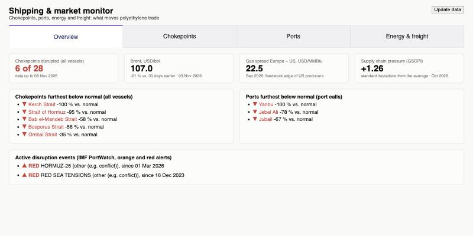
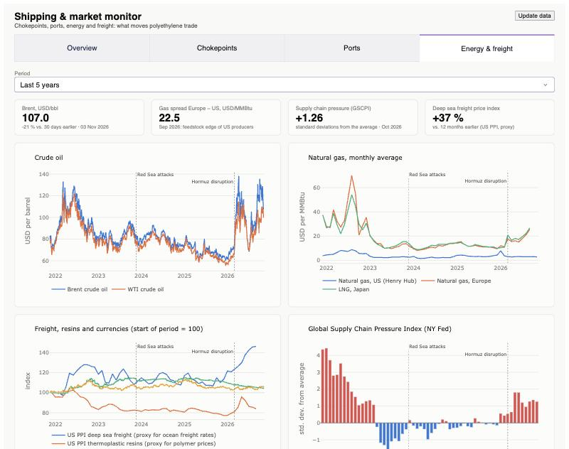
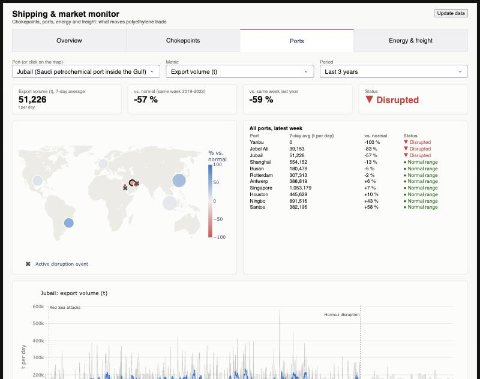
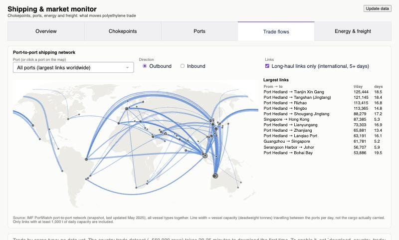

# Polymer Trade Flow & Disruption Simulator

> **Status: work in progress** (phases 1–2 done, phase 3 in progress: dashboard done, scenarios next)

What happens to polyethylene flows into Europe when the Red Sea closes, and who gains market share?
This project rebuilds global polyethylene trade (HS 3901) from official trade statistics (CEPII
BACI, reconciled UN Comtrade data, plus an own Comtrade reconciliation as a check), and explains the observed flows with a
cost-minimising transport model (linear programming). Shadow prices from the model act as implied
regional prices, and disruption scenarios (Suez/Red Sea closure, Panama Canal drought, tariffs,
plant outages, oil shocks) show how flows, costs and prices shift. Results will be explorable in an
interactive Dash app.

## Shipping & market monitor



A Dash app with five tabs on what moves polyethylene trade right now:

- **Overview:** disrupted chokepoints, oil price, gas spread Europe–US, supply-chain stress,
  ports furthest below normal and active disruption events.
- **Chokepoints:** daily transits through 28 maritime chokepoints (IMF PortWatch) against
  their 2019–2023 normal, with the Red Sea diversion (share of container ships taking the
  Cape route: ~25 % before the crisis, ~77 % since 2024).
- **Ports:** port calls and estimated trade volumes of eleven polyethylene-relevant ports
  (Houston, Jubail, Yanbu, Jebel Ali, Antwerp, Rotterdam, Shanghai, ...).
- **Trade flows:** the port-to-port shipping network (long-haul links, line width = vessel
  capacity per day) and, optionally, countries' imports and exports by cargo type.
- **Energy & freight:** Brent/WTI, natural gas in the US, Europe and Japan, freight and resin
  price indices, exchange rates and the NY Fed Global Supply Chain Pressure Index.





```bash
uv run ptf portwatch        # chokepoints, ports, events (incremental)
uv run ptf market           # FRED series and GSCPI
uv run python -m ptf.app    # open http://127.0.0.1:8050
```

## Approach

1. **Data:** CEPII BACI bilateral trade by HS6 product -> SQL models in **dbt** -> DuckDB warehouse with a star schema; own Comtrade mirror reconciliation as a check
2. **Model:** transport LP in Pyomo, solved with HiGHS; duals interpreted as regional prices
3. **Scenarios:** declarative YAML scenarios, cost curves, before/after comparison
4. **App:** Dash + Plotly

The full specification is in [SPEC.md](SPEC.md); design decisions are in
[docs/decisions.md](docs/decisions.md).

## Code structure

The package is organised by domain (ADR-012); each domain brings its downloads, its
configuration (`config/<domain>.yaml`), its logic and its pipeline steps (`steps.py`). The dbt
project uses the same domains (`dbt/models/*/{trade,shipping,markets}`).

```
src/ptf/
├── core/       settings, HTTP retries, DuckDB warehouse (dbt runs, reading marts), regions
├── trade/      CEPII BACI download and landing, region reference tables, data-quality report
├── shipping/   IMF PortWatch download, monitor metrics, port network, overview
├── markets/    FRED and GSCPI downloads, market indicators
├── model/      sea distances, transport LP, comparison with observed trade, report
├── legacy/     superseded own Comtrade download and reconciliation (check only)
├── app/        Dash app: reads the warehouse marts, calls domain functions
└── cli.py      `uv run ptf <step>`: step names -> the domains' step functions
```

Domains do not import each other: they share data through the warehouse. `uv run
lint-imports` checks these rules in CI and pre-commit.

## Tech stack

Python 3.12 · uv · pandas · Parquet + DuckDB · dbt · Pyomo + HiGHS · Dash + Plotly ·
pytest · ruff · mypy · import-linter · pre-commit · GitHub Actions · Docker · later Airflow

## How to run

Prerequisites: [uv](https://docs.astral.sh/uv/) (it installs Python 3.12 automatically).

```bash
git clone <repo-url>
cd polymer-trade-flows
uv sync                          # create .venv and install dependencies
cp .env.example .env             # optional: no API keys needed for any source
uv run pre-commit install        # run lint/format checks on every commit
uv run pytest                    # run tests
uv run ruff check .              # lint
uv run ruff format .             # format
```

### Run with Docker

Docker builds one image with code, configuration and the dbt project (ADR-013); the data
stay in `./data` on your machine and are mounted into the containers.

```bash
docker compose build                        # build the image (first time: a few minutes)
docker compose up -d app                    # dashboard on http://localhost:8050
docker compose run --rm pipeline portwatch  # any pipeline step, e.g. model, market, clean
docker compose down                         # stop the app (data stay)
```

Without data the app shows a start page with the steps to run first.

### Data pipeline

```bash
uv run ptf ingest      # BACI zip (~800 MB, downloaded once) and sea distances
uv run ptf clean       # BACI landing + dbt build -> data/warehouse.duckdb
uv run ptf report      # docs/data_quality.md + docs/figures
uv run ptf model       # transport LP -> docs/model_results.md
uv run ptf portwatch   # chokepoints, ports and events for the app
uv run ptf market      # energy, freight and supply-chain series for the app
uv run ptf all         # all of the above, in this order
```

Trade data come from CEPII BACI (ADR-009). The own Comtrade download of phase 1 is kept as a
check (`ptf comtrade`, limited by the public API's daily quota); the data-quality report
compares it with BACI.

Results so far: [data-quality report](docs/data_quality.md) ·
[model results](docs/model_results.md) ·
methodology: [docs/methodology.md](docs/methodology.md) ·
all tables and columns: [docs/data_dictionary.md](docs/data_dictionary.md)

## Roadmap

| Phase | Content | Status |
|---|---|---|
| 0 | Repo scaffold, tooling, CI | done |
| 1 | Ingest, cleaning, data-quality report | done (BACI, ADR-009) |
| 2 | Transport LP, model vs. reality, shadow prices | first version done (base year 2023) |
| 3 | Scenarios, cost curves, Dash app (MVP) | dashboard with 5 tabs done; scenarios next |
| 4 | Import forecasting (optional) | planned |
| 5 | Docker, Airflow, final polish | planned |
