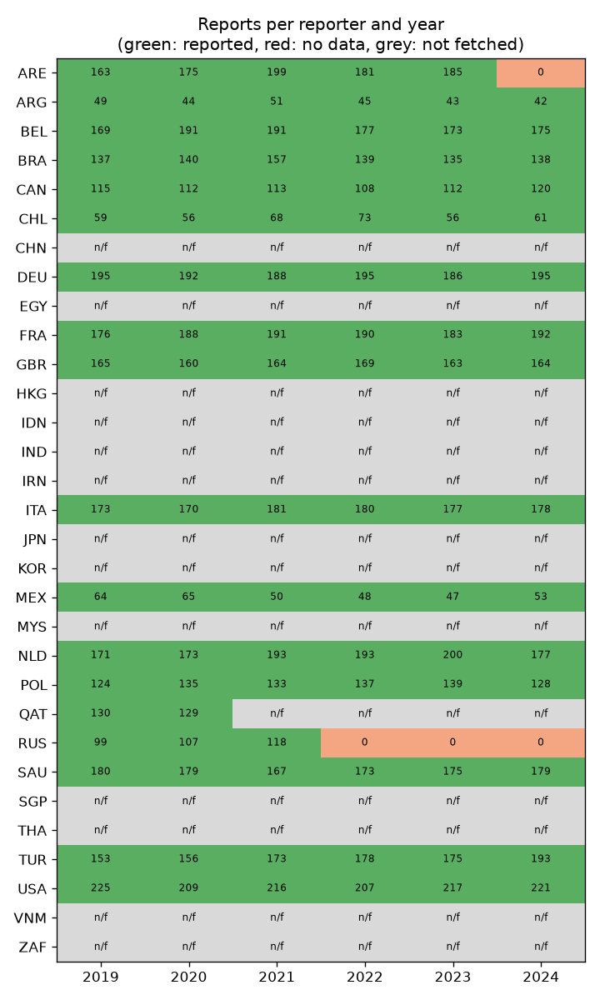
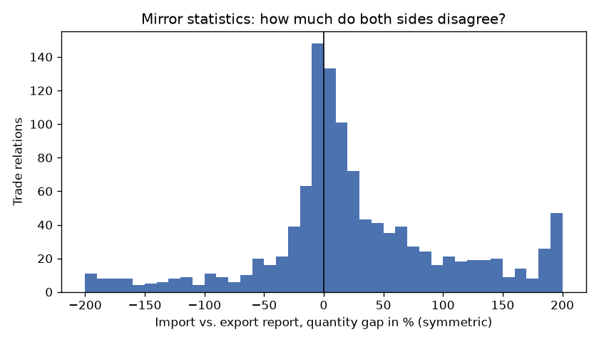
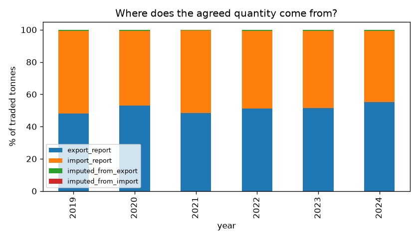

# Data-quality report (generated)

Generated by `uv run python -m ptf.pipeline report`. Do not edit by hand.

Method and rules: [methodology.md](methodology.md).

## 1. Coverage: reports per reporter and year

`<NA>` = not downloaded yet, 0 = Comtrade has no data for this reporter and year.

| reporter_iso3 | 2019 | 2020 | 2021 | 2022 | 2023 | 2024 |
|---|---|---|---|---|---|---|
| ARE | 163 | 175 | 199 | 181 | 185 | 0 |
| ARG | 49 | 44 | 51 | 45 | 43 | 42 |
| BEL | 169 | 191 | 191 | 177 | 173 | 175 |
| BRA | 137 | 140 | 157 | 139 | 135 | 138 |
| CAN | 115 | 112 | 113 | 108 | 112 | 120 |
| CHL | 59 | 56 | 68 | 73 | 56 | 61 |
| CHN | <NA> | <NA> | <NA> | <NA> | <NA> | <NA> |
| DEU | 195 | 192 | 188 | 195 | 186 | 195 |
| EGY | <NA> | <NA> | <NA> | <NA> | <NA> | <NA> |
| FRA | 176 | 188 | 191 | 190 | 183 | 192 |
| GBR | 165 | 160 | 164 | 169 | 163 | 164 |
| HKG | <NA> | <NA> | <NA> | <NA> | <NA> | <NA> |
| IDN | <NA> | <NA> | <NA> | <NA> | <NA> | <NA> |
| IND | <NA> | <NA> | <NA> | <NA> | <NA> | <NA> |
| IRN | <NA> | <NA> | <NA> | <NA> | <NA> | <NA> |
| ITA | 173 | 170 | 181 | 180 | 177 | 178 |
| JPN | <NA> | <NA> | <NA> | <NA> | <NA> | <NA> |
| KOR | <NA> | <NA> | <NA> | <NA> | <NA> | <NA> |
| MEX | 64 | 65 | 50 | 48 | 47 | 53 |
| MYS | <NA> | <NA> | <NA> | <NA> | <NA> | <NA> |
| NLD | 171 | 173 | 193 | 193 | 200 | 177 |
| POL | 124 | 135 | 133 | 137 | 139 | 128 |
| QAT | 130 | 129 | <NA> | <NA> | <NA> | <NA> |
| RUS | 99 | 107 | 118 | 0 | 0 | 0 |
| SAU | 180 | 179 | 167 | 173 | 175 | 179 |
| SGP | <NA> | <NA> | <NA> | <NA> | <NA> | <NA> |
| THA | <NA> | <NA> | <NA> | <NA> | <NA> | <NA> |
| TUR | 153 | 156 | 173 | 178 | 175 | 193 |
| USA | 225 | 209 | 216 | 207 | 217 | 221 |
| VNM | <NA> | <NA> | <NA> | <NA> | <NA> | <NA> |
| ZAF | <NA> | <NA> | <NA> | <NA> | <NA> | <NA> |

## 2. Mirror statistics (quantities)

| year | relations_total | relations_with_both_reports | median_abs_gap_pct | share_within_10pct | share_within_25pct | median_cif_fob_ratio |
|---|---|---|---|---|---|---|
| 2019 | 2302 | 214 | 40.1 | 20.6 | 41.1 | 1.3 |
| 2020 | 2332 | 220 | 32.9 | 22.3 | 45.0 | 1.2 |
| 2021 | 2325 | 205 | 25.6 | 29.8 | 48.3 | 1.2 |
| 2022 | 2187 | 179 | 31.1 | 26.8 | 44.7 | 1.2 |
| 2023 | 2164 | 175 | 36.9 | 21.1 | 41.1 | 1.2 |
| 2024 | 2036 | 153 | 28.0 | 27.5 | 47.7 | 1.1 |

### Largest disagreements in 2024 (tonnes)

| exporter_iso3 | importer_iso3 | qty_t_export | qty_t_import | gap_t | qty_gap_pct |
|---|---|---|---|---|---|
| SAU | BEL | 479,542 | 170,920 | -308,622 | -95 |
| ARG | BRA | 31,882 | 209,257 | 177,376 | 147 |
| BEL | NLD | 162,861 | 336,775 | 173,914 | 70 |
| USA | DEU | 14,028 | 129,910 | 115,882 | 161 |
| CAN | BRA | 8,825 | 124,233 | 115,408 | 173 |
| GBR | BEL | 121,299 | 7,779 | -113,520 | -176 |
| BEL | ITA | 199,064 | 310,021 | 110,957 | 44 |
| USA | BRA | 1,509,076 | 1,405,352 | -103,724 | -7 |
| USA | NLD | 98,914 | 20,667 | -78,248 | -131 |
| BRA | BEL | 71,705 | 2,763 | -68,942 | -185 |

## 3. Source of the agreed quantity (% of tonnes)

| year | export_report | import_report | imputed_from_export | imputed_from_import | estimated_by_comtrade |
|---|---|---|---|---|---|
| 2019 | 46.4 | 49.3 | 4.2 | 0.1 | 37.2 |
| 2020 | 51.0 | 44.6 | 4.4 | 0.0 | 11.0 |
| 2021 | 48.4 | 51.0 | 0.3 | 0.2 | 16.2 |
| 2022 | 51.3 | 48.1 | 0.4 | 0.1 | 19.7 |
| 2023 | 51.3 | 48.0 | 0.4 | 0.2 | 35.7 |
| 2024 | 55.0 | 44.4 | 0.4 | 0.1 | 30.6 |

## 4. Unit values and outliers

| year | flow | reports_with_unit_value | outliers | median_unit_value_usd_t | outlier_tonnage_pct |
|---|---|---|---|---|---|
| 2019 | export | 1459 | 148 | 1,306.0 | 0.1 |
| 2019 | import | 918 | 83 | 1,389.8 | 0.1 |
| 2020 | export | 1489 | 127 | 1,145.0 | 0.1 |
| 2020 | import | 921 | 81 | 1,231.4 | 0.1 |
| 2021 | export | 1514 | 126 | 1,715.6 | 0.1 |
| 2021 | import | 984 | 134 | 1,805.0 | 0.3 |
| 2022 | export | 1439 | 89 | 1,905.0 | 0.0 |
| 2022 | import | 889 | 67 | 1,960.1 | 0.5 |
| 2023 | export | 1442 | 146 | 1,544.3 | 0.0 |
| 2023 | import | 856 | 63 | 1,621.1 | 0.1 |
| 2024 | export | 1338 | 109 | 1,526.8 | 0.0 |
| 2024 | import | 815 | 76 | 1,567.7 | 0.0 |

## 5. Inter-regional trade 2024 (kt, rows export, columns import)

| exporter_region | AFR | CHN | CIS | EUR | IND | MDE | NAM | NEA | ROW | SAM | SEA |
|---|---|---|---|---|---|---|---|---|---|---|---|
| AFR | 0 | 0 | 0 | 127 | 0 | 0 | 0 | 0 | 0 | 20 | 0 |
| CHN | 0 | 0 | 0 | 105 | 0 | 35 | 50 | 0 | 0 | 37 | 0 |
| CIS | 0 | 0 | 0 | 64 | 0 | 0 | 0 | 0 | 0 | 0 | 0 |
| EUR | 49 | 347 | 44 | 0 | 135 | 54 | 86 | 27 | 2,750 | 46 | 100 |
| IND | 0 | 0 | 0 | 12 | 0 | 12 | 1 | 0 | 0 | 2 | 0 |
| MDE | 683 | 1,994 | 3 | 1,845 | 622 | 0 | 6 | 94 | 2,469 | 98 | 1,888 |
| NAM | 120 | 2,821 | 2 | 2,348 | 258 | 163 | 0 | 347 | 3,293 | 1,937 | 1,374 |
| NEA | 0 | 0 | 0 | 361 | 0 | 23 | 102 | 0 | 0 | 64 | 0 |
| ROW | 0 | 0 | 0 | 2,326 | 0 | 21 | 132 | 0 | 0 | 102 | 0 |
| SAM | 4 | 67 | 0 | 28 | 0 | 0 | 13 | 51 | 195 | 0 | 32 |
| SEA | 0 | 0 | 0 | 45 | 0 | 14 | 36 | 0 | 0 | 16 | 0 |
