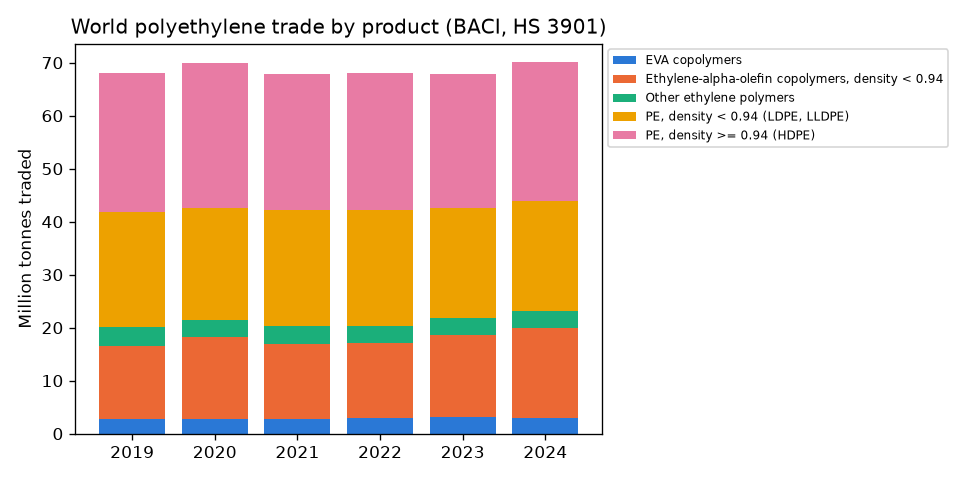
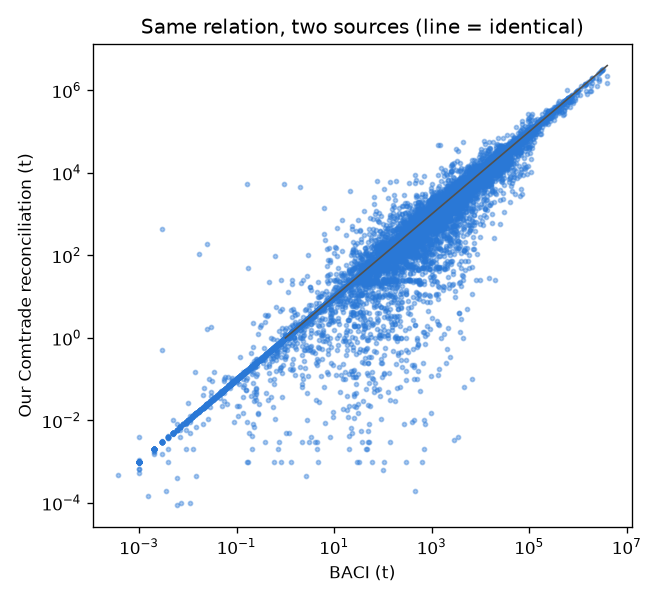

# Data-quality report (generated)

Generated by `uv run python -m ptf.pipeline report`. Do not edit by hand. Source: CEPII BACI (reconciled UN Comtrade data), see [methodology.md](methodology.md) and ADR-009.

## 1. Coverage

| year | exporters | importers | hs6_flows | traded_mt |
|---|---|---|---|---|
| 2019 | 161 | 209 | 14891 | 68.1 |
| 2020 | 162 | 207 | 15018 | 69.9 |
| 2021 | 164 | 209 | 16311 | 67.8 |
| 2022 | 171 | 208 | 15981 | 68.1 |
| 2023 | 173 | 217 | 15752 | 67.8 |
| 2024 | 164 | 213 | 14994 | 70.1 |

## 2. Traded tonnes by product (Mt)

| year | EVA copolymers | Ethylene-alpha-olefin copolymers, density < 0.94 | Other ethylene polymers | PE, density < 0.94 (LDPE, LLDPE) | PE, density >= 0.94 (HDPE) |
|---|---|---|---|---|---|
| 2019 | 2.71 | 13.81 | 3.59 | 21.78 | 26.17 |
| 2020 | 2.71 | 15.54 | 3.15 | 21.10 | 27.37 |
| 2021 | 2.72 | 14.19 | 3.34 | 22.01 | 25.59 |
| 2022 | 2.87 | 14.24 | 3.29 | 21.90 | 25.81 |
| 2023 | 3.15 | 15.54 | 3.22 | 20.70 | 25.20 |
| 2024 | 2.99 | 16.85 | 3.36 | 20.65 | 26.25 |

## 3. Missing quantities (imputed as value / median unit value)

| year | flows | imputed_flows | imputed_tonnage_pct |
|---|---|---|---|
| 2019 | 14891 | 66 | 0.0 |
| 2020 | 15018 | 80 | 0.1 |
| 2021 | 16311 | 57 | 0.0 |
| 2022 | 15981 | 58 | 0.0 |
| 2023 | 15752 | 107 | 0.0 |
| 2024 | 14994 | 77 | 0.0 |

## 4. Median unit values, USD/t (FOB, flows with reported weight)

| year | EVA copolymers | Ethylene-alpha-olefin copolymers, density < 0.94 | Other ethylene polymers | PE, density < 0.94 (LDPE, LLDPE) | PE, density >= 0.94 (HDPE) |
|---|---|---|---|---|---|
| 2019 | 2,079 | 1,356 | 2,359 | 1,298 | 1,260 |
| 2020 | 1,983 | 1,228 | 2,343 | 1,177 | 1,099 |
| 2021 | 2,659 | 1,773 | 2,648 | 1,710 | 1,548 |
| 2022 | 3,209 | 1,868 | 3,024 | 1,760 | 1,612 |
| 2023 | 2,668 | 1,483 | 2,958 | 1,409 | 1,322 |
| 2024 | 2,352 | 1,438 | 2,759 | 1,431 | 1,311 |

## 5. Inter-regional trade 2024 (kt, rows export, columns import)

| exporter_region | AFR | CHN | CIS | EUR | IND | MDE | NAM | NEA | ROW | SAM | SEA |
|---|---|---|---|---|---|---|---|---|---|---|---|
| AFR | 0 | 5 | 0 | 240 | 3 | 2 | 1 | 0 | 0 | 21 | 1 |
| CHN | 392 | 0 | 149 | 130 | 168 | 88 | 94 | 78 | 6 | 82 | 370 |
| CIS | 0 | 384 | 0 | 235 | 0 | 0 | 0 | 4 | 0 | 1 | 2 |
| EUR | 334 | 584 | 72 | 0 | 213 | 248 | 175 | 66 | 14 | 134 | 177 |
| IND | 89 | 168 | 3 | 21 | 0 | 54 | 2 | 2 | 0 | 2 | 85 |
| MDE | 2,528 | 6,676 | 204 | 2,774 | 2,533 | 0 | 42 | 383 | 62 | 178 | 2,790 |
| NAM | 674 | 3,028 | 7 | 2,707 | 383 | 315 | 0 | 289 | 38 | 2,833 | 1,390 |
| NEA | 209 | 2,747 | 137 | 558 | 379 | 72 | 120 | 0 | 49 | 113 | 1,162 |
| ROW | 1 | 15 | 1 | 2 | 2 | 1 | 3 | 0 | 0 | 0 | 17 |
| SAM | 7 | 78 | 0 | 103 | 1 | 0 | 16 | 25 | 0 | 0 | 35 |
| SEA | 107 | 3,072 | 19 | 88 | 675 | 48 | 49 | 426 | 398 | 24 | 0 |

## 6. Check: BACI vs. our own Comtrade reconciliation

Relations covered by both (our Comtrade download covers 17 reporters; ADR-009). Gap = (Comtrade − BACI) / mean of both.

| year | relations_in_both | median_abs_gap_pct | share_within_10pct | kt_baci | kt_comtrade |
|---|---|---|---|---|---|
| 2019 | 2212 | 10.9 | 49.1 | 47,364.9 | 40,966.1 |
| 2020 | 2248 | 9.6 | 50.4 | 49,235.7 | 45,382.0 |
| 2021 | 2299 | 8.7 | 51.7 | 46,129.6 | 42,519.3 |
| 2022 | 2162 | 10.1 | 50.0 | 45,779.6 | 42,719.9 |
| 2023 | 2145 | 9.5 | 51.0 | 46,274.1 | 41,196.3 |
| 2024 | 2015 | 6.1 | 56.2 | 43,993.1 | 43,254.7 |
