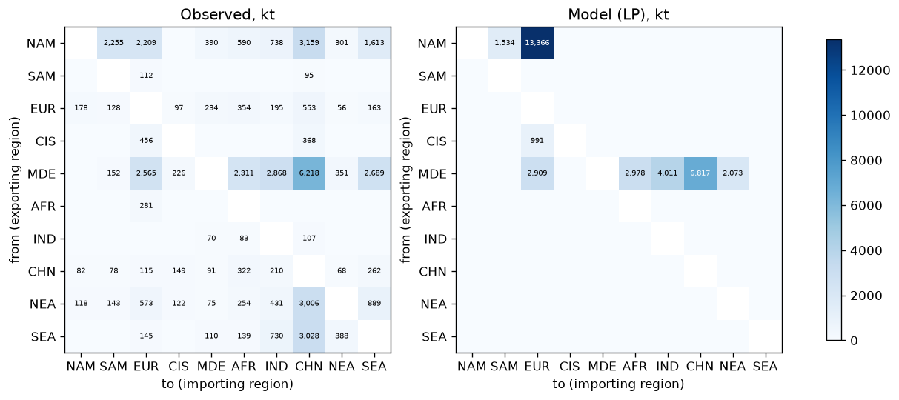

# Transport model results 2023 (generated)

Generated by `uv run python -m ptf.pipeline model`. Do not edit by hand. Assumptions: `config/model.yaml`; method and limits: [methodology.md](methodology.md#3-transport-model).

Total cost: **104.5 bn USD**, solver status: optimal.

## 1. Regions: implied prices and scarcity rents

`price_usd_t` = dual of the demand constraint (marginal delivered cost of one more tonne). `rent_usd_t` = dual of the capacity constraint (cost saving from one more tonne of capacity; 0 for regions with idle capacity).

| region | capacity_kt | model_supply_kt | utilisation_pct | demand_kt | unmet_kt | prod_cost_usd_t | price_usd_t | rent_usd_t |
|---|---|---|---|---|---|---|---|---|
| NAM | 34,000 | 34,000 | 100 | 19,100 | 0 | 650 | 1,026 | 376 |
| SAM | 5,000 | 5,000 | 100 | 6,534 | 0 | 1,100 | 1,106 | 6 |
| EUR | 17,000 | 0 | 0 | 17,265 | 0 | 1,200 | 1,102 | 0 |
| CIS | 5,000 | 5,000 | 100 | 4,009 | 0 | 700 | 1,053 | 353 |
| MDE | 23,000 | 23,000 | 100 | 4,211 | 0 | 500 | 1,018 | 518 |
| AFR | 3,000 | 3,000 | 100 | 5,978 | 0 | 900 | 1,086 | 186 |
| IND | 7,000 | 7,000 | 100 | 11,011 | 0 | 1,000 | 1,066 | 66 |
| CHN | 38,000 | 38,000 | 100 | 44,817 | 0 | 1,000 | 1,098 | 98 |
| NEA | 10,000 | 1,467 | 15 | 3,541 | 0 | 1,100 | 1,100 | 0 |
| SEA | 11,000 | 9,602 | 87 | 9,602 | 0 | 1,050 | 1,050 | 0 |

## 2. Model vs. observed inter-regional trade

| metric | value |
|---|---|
| observed inter-regional trade (kt) | 44,061 |
| model inter-regional trade (kt) | 34,680 |
| explained share (%) | 42.0 |
| routes used: observed / model / both | 90 / 8 / 8 |
| correlation model vs. observed | 0.57 |

### Largest observed routes

| origin_region | dest_region | observed_kt | model_kt |
|---|---|---|---|
| MDE | CHN | 6,218 | 6,817 |
| NAM | CHN | 3,159 | 0 |
| SEA | CHN | 3,028 | 0 |
| NEA | CHN | 3,006 | 0 |
| MDE | IND | 2,868 | 4,011 |
| MDE | SEA | 2,689 | 0 |
| MDE | EUR | 2,565 | 2,909 |
| MDE | AFR | 2,311 | 2,978 |
| NAM | SAM | 2,255 | 1,534 |
| NAM | EUR | 2,209 | 13,366 |
| NAM | SEA | 1,613 | 0 |
| NEA | SEA | 889 | 0 |
| NAM | IND | 738 | 0 |
| SEA | IND | 730 | 0 |
| NAM | AFR | 590 | 0 |

### Routes the model uses

| origin_region | dest_region | model_kt | observed_kt |
|---|---|---|---|
| NAM | EUR | 13,366 | 2,209 |
| MDE | CHN | 6,817 | 6,218 |
| MDE | IND | 4,011 | 2,868 |
| MDE | AFR | 2,978 | 2,311 |
| MDE | EUR | 2,909 | 2,565 |
| MDE | NEA | 2,073 | 351 |
| NAM | SAM | 1,534 | 2,255 |
| CIS | EUR | 991 | 456 |
